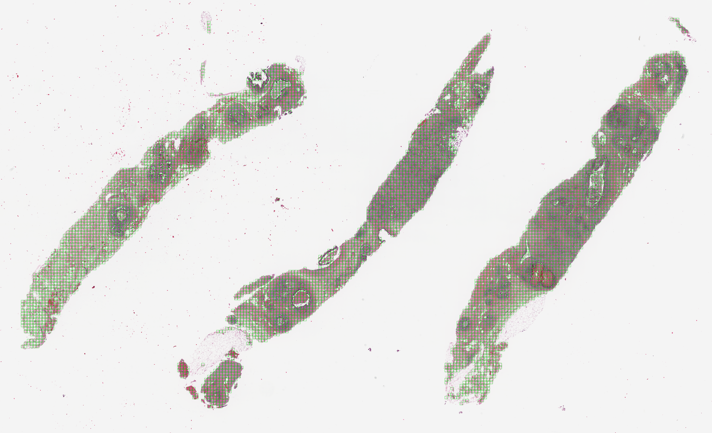

# her2-pcr-pathology-fm

Predicting pathological complete response (pCR) to neoadjuvant anti-HER2 therapy in HER2+ breast cancer from pre-treatment H&E core biopsy whole-slide images, using frozen pathology foundation models and multiple instance learning (MIL).

Inspired Mallya et al. (2024), *Benchmarking histopathology foundation models for ovarian cancer bevacizumab treatment response prediction*. This project uses a similar foundation model + MIL pipeline for HER2+ breast cancer, training on one public cohort and testing on a second cohort from a different hospital.

**Status:** work in progress. Tiling, feature extraction (Lunit-DINO), evaluation harness and baseline models are done. MIL models are next.

## Data

| Cohort | Role | Patients | pCR / non-pCR | Source |
|---|---|---|---|---|
| Yale trastuzumab response | Training + CV | 85 | 36 / 49 | TCIA, CC BY 4.0 |
| IMPRESS (HER2+) | External test | 62 | 38 / 24 | Huang et al. 2023 |

One slide per patient. Both cohorts scanned at ~0.5 µm/px (20×).

## Pipeline

1. **Manifest** (`manifest.py`): builds one table linking each slide to its patient and label, and checks for missing or duplicate patients.
2. **Tiling** (`tiling.py`): Otsu thresholding on saturation, clamped to [15, 25], on a low-resolution thumbnail. 224 px tiles at 0.5 µm/px. Tiles with ≥50% tissue kept, all tiles used (no sampling), no stain normalisation. About 493k tiles in total (median 2,200 per slide for Yale and 3,748 for IMPRESS).
   

     
   

   
<em>Retained tiles (green) on a Yale biopsy thumbnail.</em>

4. **Feature extraction** (`extract_features.py`): passes every tile through a frozen Lunit-DINO ViT-S/16 model, resulting in a 384-dimension embedding per tile.
5. **Evaluation** (`evaluate.py`): repeated stratified 5-fold CV on Yale patients (10 repeats), AUC is reported with patient-level bootstrap 95% confidence interval. IMPRESS is held out until final model parameters are fixed.

## Results so far (Yale, 5-fold CV × 10)

| Method | AUC (mean ± SD across repeats) | 95% CI |
|---|---|---|
| Tile count only | 0.42 ± 0.00 | 0.30 to 0.54 |
| Mean pooling + PCA + logistic regression | 0.65 ± 0.03 | 0.55 to 0.78 |

**Domain shift between cohorts.** Yale and IMPRESS come from different hospitals and scanners, so their tile features look systematically different:

- For a random tile, I found its 10 most similar tiles from other patients and checked how many came from the same cohort.
- Yale tiles matched other Yale tiles 92% of the time, and IMPRESS tiles matched other IMPRESS tiles 85% of the time. If cohort didn't matter, these would be about 58% and 42% (each cohort's share of the tiles).
- Standardising the features within each cohort lowered this to 77% and 68%, so part of the difference is a simple overall offset and part is more complex.

**Tissue amount.** The number of tiles per slide predicts pCR weakly in IMPRESS (AUC 0.66, 95% CI 0.51 to 0.80) but not in Yale (0.42, CI 0.30 to 0.54). Models are compared against this to make sure they aren't just learning how much tissue a biopsy has.

## Notes and Decisions
Data
- Cannot verify that treatment is identical between the two cohorts. Both received trastuzumab-based therapy, but the chemotherapy given to the Yale cohort isn’t reported so I should keep that in mind.

Tiling
- some slides first had very high automatic saturation thresholds which dropped some pale tissue. I capped the threshold at 25 which recovered some of the pale tissue while still excluding the glass.

Evaluation
- Tile features cluster strongly by hospital which means a drop in AUC on the external test set is likely. Knowing this is useful to separate model training issues from differences that come from the data itself.
## Next steps

- [ ] ABMIL, then TransMIL, CLAM and VarMIL
- [ ] External test on IMPRESS data with fixed model configurations
- [ ] Attention heatmaps and explainability
- [ ] CONCH ViT-B/16 features for an encoder comparison
- [ ] Reverse train/test direction (train using IMPRESS, external test with Yale)

## References

- Mallya M., Khajegili Mirabadi A., Farnell D., Farahani H., Bashashati A. et al. (2025). Benchmarking histopathology foundation models for ovarian cancer bevacizumab treatment response prediction from whole slide images. *Discover Oncology* 16:196. https://doi.org/10.1007/s12672-025-01973-x
- Farahmand S., Fernandez A.I., Ahmed F.S., Rimm D.L., Chuang J.H., Reisenbichler E., Zarringhalam K. (2022). HER2 and trastuzumab treatment response H&E slides with tumor ROI annotations (Version 3) [Data set]. The Cancer Imaging Archive. https://doi.org/10.7937/E65C-AM96
- Farahmand S. et al. (2022). Deep learning trained on H&E tumor ROIs predicts HER2 status and trastuzumab treatment response in HER2+ breast cancer. *Modern Pathology* 35:44–51. https://doi.org/10.1038/s41379-021-00911-w
- Huang Z. et al. (2023). Artificial intelligence reveals features associated with breast cancer neoadjuvant chemotherapy responses from multi-stain histopathologic images. *npj Precision Oncology* 7:14. Data: https://tinyurl.com/IMPRESS-DATA.
- Kang M. et al. (2023). Benchmarking self-supervised learning on diverse pathology datasets. *CVPR*. (Lunit-DINO)
